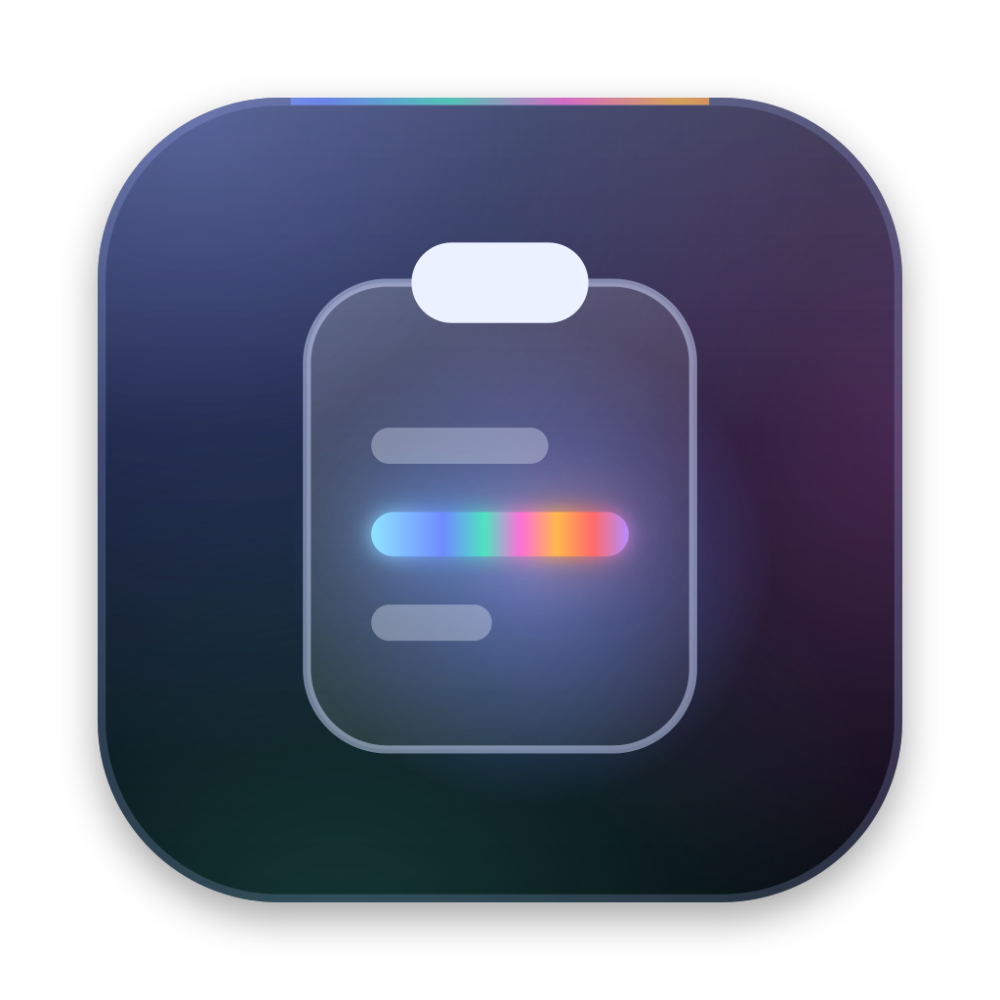
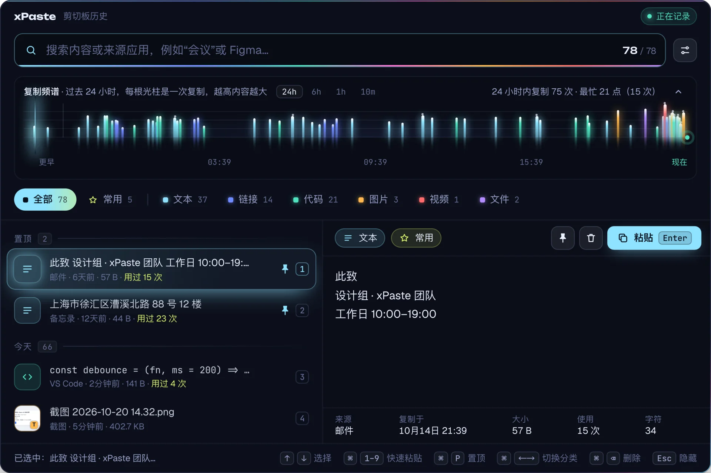

<div align="center">



# xPaste

免费、开源、纯本地的 macOS / Windows 剪切板历史，自带截图、贴图、录屏和翻译。<br>截图里的字、文件里的内容、拼音首字母，都能搜到。

[](https://github.com/Cocoon-break/xpaste/actions/workflows/ci.yml)
[](https://github.com/Cocoon-break/xpaste/releases/latest)
[](LICENSE)

[官网](https://cocoon-break.github.io/xpaste/) · [下载](#下载安装) · [功能规格说明](docs/xPaste-功能规格说明.md) · [参与开发](CONTRIBUTING.md)



</div>

按一个快捷键唤起面板，搜索、预览，再把任意一条复制过的内容贴回当前应用。和同类工具相比，xPaste 的不同之处在于**图片和文件里的内容也能搜**。

截图、贴图和录屏（录屏仅 macOS）也在 xPaste 里，不用另装工具：截下的图直接进历史，随后能按图里的字搜到；录下的视频同样作为一条记录进入历史，可以直接粘贴。在任何应用里选中的文字、截图里的字都能直接翻译，也可以自己写一段再翻；常用的一段话可以存成片段，搜名字就能粘贴。

## 功能

- **截图里的字能搜到。** 截过一张图，只记得图里有某个数字或某句话，照样能搜出来。截图和复制的图片在后台用系统自带的离线文字识别（macOS Vision、Windows.Media.Ocr）读出文字，不联网、不上传、不下载模型，也不增加安装体积；一次复制的多张图片会一起识别。命中时列表行写明“识别文字中含……”，预览里可以看全文、一键复制。
- **截图、标注、钉在屏幕上。** 按 `⌥ + Shift + A`（Windows `Alt + Shift + A`）冻结所有屏幕，单击选中窗口、拖动框选，或按 `F` 选整块屏；`1`–`7` 依次是矩形、椭圆、箭头、画笔、马赛克、文字、序号。回车复制，截图直接进历史，之后能按图里的字搜到；`⌘ S`（Windows `Ctrl + S`）保存到截图文件夹，`O` 只复制图里的文字（作为一条文本记录进历史），`P` 把截图钉在屏幕上当参考：可以拖动、滚轮缩放（20%–400%）、双击关闭，右键复制或保存。按 `L` 长截图：自己往下滚动选区里的内容，xPaste 边滚边拼，选区旁有预览可以看接得对不对，回车完成、进历史，`Esc` 取消；滚得太快接不上时往回滚一点就能接着拼。
- **录屏（仅 macOS 13+）。** 按 `⌥ + Shift + R`，用截图同样的遮罩选窗口、区域或整块屏，倒计时 3 秒后录成 MP4（H.264，30 或 60 fps，清晰度可选），可以带系统声音和麦克风（麦克风要 macOS 15）；录制中菜单栏显示 `● mm:ss`，再按一次快捷键或点菜单“停止录制”结束，结果显示在屏幕左下角。视频存进录屏文件夹（默认 `~/Movies/xPaste`），同时作为视频记录进入历史，可以直接粘贴。Windows 暂不支持录屏。
- **拼音、首字母都能搜。** 不用切输入法，打 `huiyi` 或 `hy` 就能找到“会议”；多音字也认得，`yinhang` 能找到“银行”，命中的字直接高亮。
- **文件按内容找。** 打开“搜索文本文件内容”后，复制的 txt、md、csv、json、代码等文件的内容也能搜到，忘了文件名也能找回来。这个选项默认关闭，由你决定要不要为此多占一点磁盘。
- **历史再多也不卡。** 三个字符以上的搜索走本地全文索引，几百 MB 的历史文本也是毫秒级；连续输入会合并查询，不会越打越慢。
- **隐私是硬约束，不是开关。** 所有数据只在本机，没有账号、没有云同步、没有使用统计；唯一的外发是你手动翻译时把那段文字发到你自己配置的翻译接口。来自密码管理器或被系统标记为敏感的内容默认不记录；日志里从不出现剪切板内容、标题、文件路径和搜索词。
- **选中就能翻译，也能写完再翻。**
  - 面板里选中一段文字（或有识别文字的截图、文件）按 `⌘ T`（Windows `Ctrl + T`），译文显示在预览里并存下来，下次直接看。
  - 截图框选后按 `T`，先识别再翻译，译文卡片出现在选区旁。
  - 在浏览器、终端等任何应用里选中文字按 `⌥ ⇧ T`（Windows `Alt + Shift + T`），译文出现在文字旁；点“对照原文”展开成左右两栏，可以直接改原文、换目标语言再翻，按住标题行能拖走。
  - 想自己写一段再翻（比如写好中文翻成英文发出去），点菜单栏图标的“翻译…”，或者不选文字直接按翻译快捷键：写完按 `⌘ ↵` 翻译，再按一次复制，回到聊天框粘贴即可；没写完关掉，下次打开草稿还在。
  - 可以用 macOS 26 自带的离线系统翻译（缺语言包时在 xPaste 里一键下载），或者接任意 OpenAI 兼容接口（包括本机的 Ollama），流式出字。两种都配好时，设置里选默认用哪种；每段译文都标出用的是哪种，翻译中、翻译后都能临时换用另一种。只在你按翻译时才发送那一段文字。
- **常用的一段，存成片段。** 地址、回复模板、命令，起个名字存下来，在“全部”里搜名字（拼音、首字母也行）就能找到，Enter 粘贴出的是内容。片段不受保留时长、条数上限和“清空历史”影响。
- **两个系统，一套习惯。** macOS 与 Windows 共用同一份核心代码，交互、快捷键、外观都一样，换电脑不用换工具。
- **看得见的复制节奏。** 面板顶部的复制频谱让你一眼看到最近复制了什么、复制了多少；“常用”分类按使用次数自动归类，阈值可调。
- **顺手的细节。**
  - 误删 5 秒内可撤销；
  - 数字键直接粘贴前几条；
  - 搜索框为空时按退格不会误删记录；
  - Esc 先清空搜索，再隐藏面板；
  - 面板出现在鼠标所在的显示器。

有意不做的：跨设备同步（和“数据不离开本机”冲突）、带占位符的片段与输入缩写自动展开、自动翻译（复制或选中时自动发请求）。

## 下载安装

| 系统 | 安装包 |
|---|---|
| macOS 13+ · Apple 芯片（M 系列） | [xPaste_aarch64.dmg](https://github.com/Cocoon-break/xpaste/releases/latest/download/xPaste_aarch64.dmg) |
| macOS 13+ · Intel | [xPaste_x64.dmg](https://github.com/Cocoon-break/xpaste/releases/latest/download/xPaste_x64.dmg) |
| Windows 10 21H2 / 11 · x64 | [xPaste_x64-setup.exe](https://github.com/Cocoon-break/xpaste/releases/latest/download/xPaste_x64-setup.exe) |

上面的链接始终指向最新版，历史版本在 [Releases](https://github.com/Cocoon-break/xpaste/releases)。

**macOS**：打开 dmg，把 xPaste 拖进“应用程序”。安装包还没有签名，从浏览器下载后第一次打开会被系统拦下，可能提示“xPaste 已损坏，无法打开”，而且没有“仍要打开”按钮。这不是文件坏了，按下面的顺序放行：

1. 在终端运行 `xattr -dr com.apple.quarantine /Applications/xPaste.app`（去掉隔离属性），再正常打开。这一步在各版本 macOS 上都有效。
2. 如果弹窗写的是“无法验证开发者”而不是“已损坏”，也可以先双击打开一次，再到系统设置 → 隐私与安全性，在页面底部点“仍要打开”（出现这个按钮时才行）。
3. 仅限 macOS 13–14：在访达的“应用程序”里按住 Control 点按 xPaste →“打开”，在弹窗里再点“打开”。从 macOS 15 起，这个方法不再能绕过拦截。

**Windows**：运行安装程序，它会装到当前用户目录（`%LOCALAPPDATA%\xPaste`），不需要管理员权限。SmartScreen 提示“Windows 已保护你的电脑”时，点“更多信息 → 仍要运行”。部分 Windows 10 没有 WebView2 运行时，安装程序会在线下载，需要联网。

### 支持情况

| 设备 | 情况 |
|---|---|
| macOS 13.1 及以上 · Apple 芯片 / Intel | 全部功能 |
| macOS 13.0 | 能用；系统自带的 WebKit 太旧，个别描边、高亮不显示，升级到 13.1 或更新 Safari 即可 |
| macOS 12 及以下 | 不支持，系统会拒绝打开 |
| Windows 11 / Windows 10 21H2 及以上 · x64 | 除录屏外全部功能；Windows 10 上面板是不透明背景。翻译已在实机上验收，截图、贴图、长截图还在验收中 |
| Windows 10 低于 21H2 | 没测过；安装时会提示，由你决定是否继续 |
| Windows 11 on ARM | 靠系统的 x64 模拟运行，没测过 |
| Windows 10 on ARM | 不能运行，安装程序会说明原因并退出 |

部分功能对系统版本或权限有要求，不满足时对应选项不显示、不可用，或者会告诉你该怎么做：

- 录屏只有 macOS；录屏带麦克风要 macOS 15；系统翻译要 macOS 26，之前的 macOS 和 Windows 上用 OpenAI 兼容接口翻译。
- macOS 上截图、录屏要“屏幕录制”权限，回车自动粘贴与划词翻译要“辅助功能”权限，按快捷键时没有权限会弹出授权提示；Windows 不需要额外权限，但粘贴不进以管理员身份运行的窗口（会改为只复制并提示手动粘贴）。
- Windows 上识别图片文字要系统装了 OCR 语言包，没装时设置里会写明去哪里添加。
- 快捷键被其他应用占用时，打开设置能看到哪个没生效；录屏、长截图的结果直接显示在屏幕上，系统里关掉了 xPaste 的通知也能看到。

完整的支持情况（显示器、HDR、多屏、还能做的优化）见 [docs/设备支持.md](docs/设备支持.md)。

## 快速上手

- 按 `⌘ + Shift + V`（macOS）/ `Ctrl + Shift + V`（Windows）唤起面板，快捷键可以在设置里改。第一次启动有引导。
- 直接打字搜索，按 Enter 粘贴到上一个应用：
  - macOS 上自动粘贴需要“辅助功能”权限（系统设置 → 隐私与安全性 → 辅助功能）。
  - 不授权也能用：Enter 只复制并提示，到目标应用里手动按 `⌘ + V` 即可。
- 右键一条记录（或按 `Shift + F10`）：
  - 可以粘贴、置顶、删除；
  - 链接可以“在浏览器中打开”；
  - 文件、视频和来自文件的图片可以“在访达中显示” / “在资源管理器中显示”。
- 片段：
  - 历史记录上右键“存为片段…”，或在设置的“记录”标签里“新建片段…”，起个名字；
  - 在“全部”里搜名字（支持拼音与首字母）就能找到，Enter 粘贴出的是内容；
  - 片段不受保留时长、最多条数和“清空历史”影响，只在“片段”分类里删除（`Mod` 点击可多选）。
- 复制频谱：
  - 点标题行可以收起，收起后只留一行统计；
  - 滚轮或双指捏合可以放大到几分钟，拖动平移，双击回到 24 小时；
  - 标题行的 `24h` `6h` `1h` `10m` 直接跳到对应时长。
- 图片里的文字：
  - 搜索命中图中文字时，预览里展开“图中文字”可以看全文、点“复制文字”复制；
  - 设置里可以关掉识别，或关掉“为已有图片补识别”。
- 截图：
  - macOS 第一次截图前要授予“屏幕录制”权限（系统设置 → 隐私与安全性 → 屏幕录制，macOS 15 起叫“录屏与系统录音”），授权后重新打开 xPaste；
  - 截图快捷键、截图文件夹、保存时是否同时复制，都在设置的“截图”标签里改；
  - 遮罩里 `1`–`7` 选标注工具，`⌘ Z`（Windows `Ctrl + Z`）撤销，Esc 直接退出，右键先取消选区、再退出。
- 录屏（仅 macOS）：
  - 和截图用同一个“屏幕录制”权限；开着麦克风第一次录制时，系统会再问一次麦克风权限；
  - 遮罩工具栏上的系统声音、麦克风开关会被记住，录屏快捷键、录屏文件夹、录完是否复制，都在设置的“截图”标签里改；
  - 录制中不能截图，先停止录制。
- 翻译：
  - 第一次用先到设置的“翻译”标签：macOS 26 起可以直接用系统翻译（看“语言包”一行，缺了点“下载语言包”）；要用 AI 翻译，在“AI 翻译”一组填接口地址、API Key 和模型 ID，点“测试翻译”确认能用；
  - 两种都配好时，“默认翻译方式”决定先用哪种，译文上的“换用…”可以临时改用另一种；
  - 划词翻译靠模拟一次“复制”取词，macOS 上要“辅助功能”权限，没授权时翻译的是剪切板里原有的文字；翻译快捷键可以在设置里改或清空；
  - 划词卡片和输入卡片：回车（展开时 `⌘ ↵`）复制译文，Esc 或点别处关闭。
- 设置里的“外观”点选即生效，不用再点“保存设置”。
- 托盘菜单：
  - “翻译…”打开输入卡片；
  - “暂停记录”在重启后仍然有效；
  - 菜单底部灰色的“xPaste <版本>”是当前版本号。

## 数据与隐私

数据只存在本机，不同步、不收集使用统计。唯一会联网的是翻译：只在你手动翻译时，把那段文字发到你在设置里配置的接口（接本机服务或用系统翻译时不出本机）。数据目录：

- macOS：`~/Library/Application Support/xPaste/`
- Windows：`%APPDATA%\xPaste\`

设置里可以“清空历史…”，置顶的记录与片段会保留。数据库没有加密，是本机明文 SQLite，靠系统账户权限保护。

## 卸载

- **macOS**：
  1. 从菜单栏图标选“退出 xPaste”，把应用拖进废纸篓。
  2. 要连数据一起删，还需手动删除这些位置：
     - 上面的数据目录；
     - `~/Library/LaunchAgents/` 下 xPaste 的 plist（开过“开机时启动”才有）；
     - WebView 留下的 `~/Library/WebKit/com.xpaste.app` 和 `~/Library/Caches/com.xpaste.app`。
- **Windows**：在“设置 → 应用”里卸载。要删历史数据，在卸载确认页勾选“删除应用程序数据”。

## 已知限制

- 安装包没有签名，也没有自动更新，新版本要手动下载安装。
- Windows 端的翻译、划词翻译已在实机上验收，截图、贴图、长截图还只在 CI 上编译并跑通单元测试；图片文字识别依赖系统已安装的 OCR 语言包。
- macOS 分 Apple 芯片和 Intel 两个安装包，没有通用版本。
- 截图的选区不能跨显示器；贴图退出 xPaste 就消失，重启不恢复。macOS 15 起系统会定期再次询问是否继续允许屏幕录制。
- 录屏只支持 macOS，麦克风要 macOS 15；同时录系统声音和麦克风时是两条音轨，有的播放器只播第一条。只有从菜单栏“退出 xPaste”会先把视频写完，录制中注销、关机或用 `⌘ Q` 结束 xPaste 时，正在录的视频无法播放。
- 应用启动后第一次识别图片要加载系统模型，大约 8 秒，之后每张通常不到 1 秒。
- 翻译要联网，接本机服务（如 Ollama）时除外；系统翻译需要 macOS 26，命令、路径也会被翻译；Windows 上没有系统翻译，只能用 OpenAI 兼容接口。划词翻译在 macOS 上要“辅助功能”权限；Windows 上用 `Ctrl + Insert` 取词，个别不认它的应用里翻译的是剪切板里原有的文字。

完整列表（包括性能测量结果、各平台的细节）见 [docs/已知限制.md](docs/已知限制.md)；各系统、芯片、显示器与权限下哪些功能可用、不可用时有什么提示，见 [docs/设备支持.md](docs/设备支持.md)。

## 参与开发

需要 Node.js、pnpm 和 Rust ≥ 1.90：

```sh
make install       # 安装依赖
make dev-isolated  # 开发运行，数据目录隔离在 .xpaste-dev/
make check         # 提交前全量检查
```

目录结构、分支流程、发版与签名见 [CONTRIBUTING.md](CONTRIBUTING.md)。

## 文档

- [功能规格说明](docs/xPaste-功能规格说明.md)：每个功能的规则与验收标准
- [技术选型](docs/ADR-001-技术选型.md)
- [实现设计](docs/specs/2026-10-18-xPaste-实现设计.md)：设计文档放在 `docs/specs/`，实施计划放在 `docs/plans/`
- [验收记录](docs/验收记录.md)
- [交互原型](docs/xpaste-prototype.html)：下载后用浏览器直接打开

## 许可证

[MIT](LICENSE)
