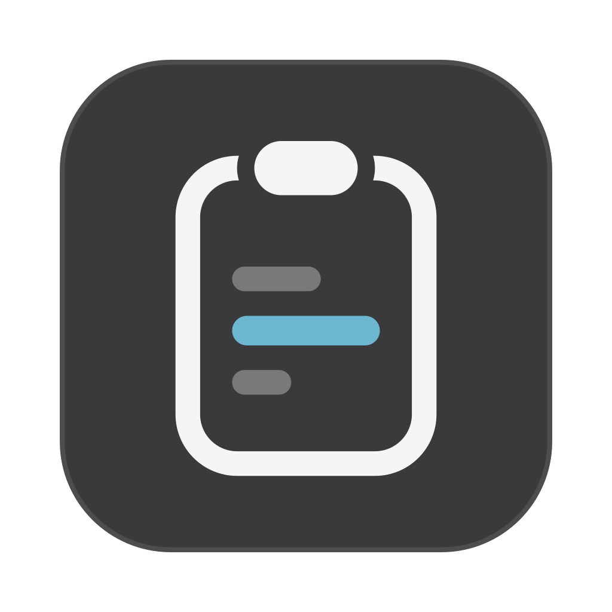
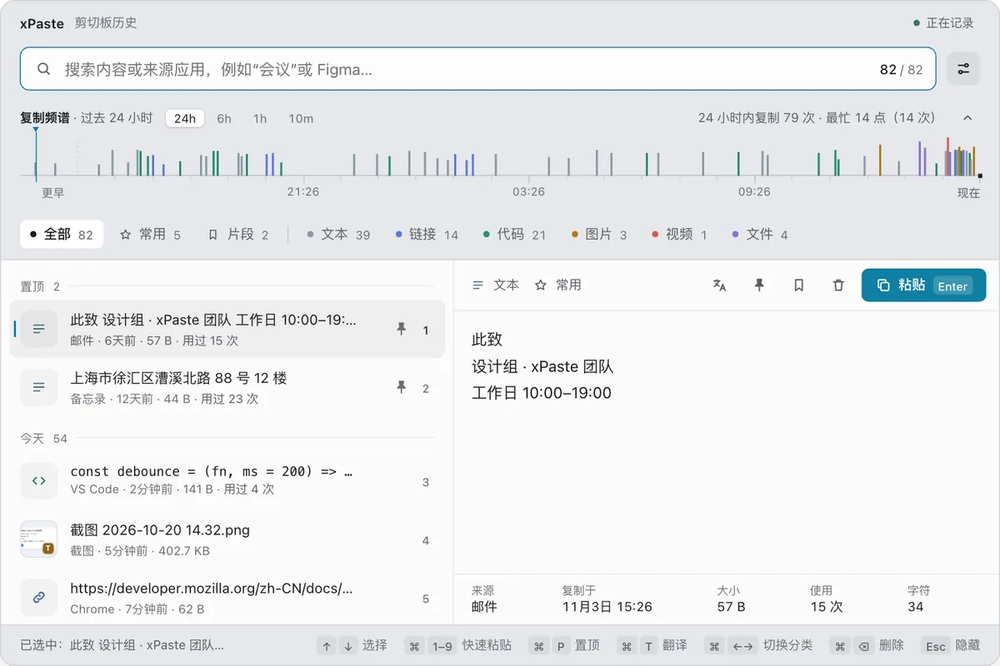

<div align="center">



# xPaste

**只记得一点点，也找得回来**

macOS 和 Windows 上免费、开源、纯本地的剪切板历史。<br>截图里的字、文件里的内容、拼音首字母，都能搜到。

[](https://github.com/Cocoon-break/xpaste/releases/latest)
[](LICENSE)

[官网](https://cocoon-break.github.io/xpaste/) · [下载](#下载) · [使用说明](docs/使用说明.md) · [参与开发](CONTRIBUTING.md)

<picture>
  <source media="(prefers-color-scheme: dark)" srcset="docs/screenshots/demo-dark.webp">
  
</picture>

</div>

## 只记得……

- **截图里有个会议号**：截图和复制的图片在本机识别文字，搜那几个字，截图就排在最前。
- **拼音首字母**：不用切输入法，打 `hy` 找到“会议”，打 `yinhang` 找到“银行”。
- **文件里写过的一句话**：txt、md、代码文件的内容也能搜，忘了文件名也找得回来。
- **大概是什么时候复制的**：复制频谱从 24 小时一路放大到 10 分钟，在时间里找。

按 <kbd>⌘</kbd> <kbd>Shift</kbd> <kbd>V</kbd>（Windows <kbd>Ctrl</kbd> <kbd>Shift</kbd> <kbd>V</kbd>）唤起，按 <kbd>Enter</kbd> 贴回刚才的应用。还自带截图、贴图、录屏（仅 macOS）和划词翻译。全部功能见[使用说明](docs/使用说明.md#功能)。

## 下载

| 系统 | 安装包 |
|---|---|
| macOS 13+ · Apple 芯片 | [xPaste_aarch64.dmg](https://github.com/Cocoon-break/xpaste/releases/latest/download/xPaste_aarch64.dmg) |
| macOS 13+ · Intel | [xPaste_x64.dmg](https://github.com/Cocoon-break/xpaste/releases/latest/download/xPaste_x64.dmg) |
| Windows 10 21H2 / 11 · x64 | [xPaste_x64-setup.exe](https://github.com/Cocoon-break/xpaste/releases/latest/download/xPaste_x64-setup.exe) |

macOS 也可以用 Homebrew：

```sh
brew trust --cask cocoon-break/tap/xpaste
brew install --cask cocoon-break/tap/xpaste
```

macOS 安装包已签名并经过 Apple 公证，第一次打开时系统会确认一次，点“打开”即可。Windows 安装包还没有签名，SmartScreen 提示时点“更多信息 → 仍要运行”。权限、系统要求和旧版本的放行办法见[使用说明](docs/使用说明.md#下载安装)。

## 数据只在你的电脑上

没有账号，没有云同步，也没有使用统计。会联网的只有两件事：你手动发起的翻译，只发送要翻译的那一段文字；每天向 GitHub 查一次有没有新版本，不发送任何数据，可以在设置里关掉。代码全部开源，网络请求和日志写了什么，都可以自己看。

## 参与开发

需要 Node.js、pnpm 和 Rust ≥ 1.90：

```sh
make install       # 安装依赖
make dev-isolated  # 开发运行，数据目录隔离在 .xpaste-dev/
make check         # 提交前全量检查
```

目录结构、分支流程、发版与签名见 [CONTRIBUTING.md](CONTRIBUTING.md)。设计与规格文档：[功能规格说明](docs/xPaste-功能规格说明.md) · [技术选型](docs/ADR-001-技术选型.md) · [实现设计](docs/specs/2026-10-18-xPaste-实现设计.md) · [界面视觉「刻度」](docs/specs/2026-11-03-界面视觉规范-刻度-设计.md) · [验收记录](docs/验收记录.md) · [已知限制](docs/已知限制.md)

## 许可证

[MIT](LICENSE)
