# xPaste 使用说明

安装、全部功能、快捷键、权限、数据与卸载。产品介绍见 [README](../README.md) 或[官网](https://cocoon-break.github.io/xpaste/)；每个功能的规则与验收标准见[功能规格说明](xPaste-功能规格说明.md)。

下面的截图来自真实界面和演示数据，跟随你的系统深浅色显示。快捷键按 macOS 写，Windows 上把 `⌘` 换成 `Ctrl`、`⌥` 换成 `Alt`。

**目录**：[下载安装](#下载安装) · [快速上手](#快速上手) · [功能](#功能) · [设置](#设置) · [菜单栏与托盘](#菜单栏与托盘) · [快捷键一览](#快捷键一览) · [数据与隐私](#数据与隐私) · [卸载](#卸载) · [已知限制](#已知限制)

## 下载安装

| 系统 | 安装包 |
|---|---|
| macOS 13+ · Apple 芯片（M 系列） | [xPaste_aarch64.dmg](https://github.com/Cocoon-break/xpaste/releases/latest/download/xPaste_aarch64.dmg) |
| macOS 13+ · Intel | [xPaste_x64.dmg](https://github.com/Cocoon-break/xpaste/releases/latest/download/xPaste_x64.dmg) |
| Windows 10 21H2 / 11 · x64 | [xPaste_x64-setup.exe](https://github.com/Cocoon-break/xpaste/releases/latest/download/xPaste_x64-setup.exe) |

上面的链接始终指向最新版，历史版本在 [Releases](https://github.com/Cocoon-break/xpaste/releases)。

macOS 也可以用 Homebrew 安装（[Cocoon-break/homebrew-tap](https://github.com/Cocoon-break/homebrew-tap)）：

```sh
brew trust --cask cocoon-break/tap/xpaste   # Homebrew 要求先信任第三方 tap 里的 cask
brew install --cask cocoon-break/tap/xpaste
brew upgrade --cask xpaste                  # 以后升级
```

### 第一次打开

**macOS**：打开 dmg，把 xPaste 拖进“应用程序”。安装包用 Developer ID 签名并经过 Apple 公证，第一次打开时系统会提示“xPaste 是从互联网下载的 App”，点“打开”即可，之后不再出现。

**Windows**：运行安装程序，它会装到当前用户目录（`%LOCALAPPDATA%\xPaste`），不需要管理员权限。安装包没有签名，SmartScreen 提示“Windows 已保护你的电脑”时，点“更多信息 → 仍要运行”。部分 Windows 10 没有 WebView2 运行时，安装程序会在线下载，需要联网。

### 支持情况

| 设备 | 情况 |
|---|---|
| macOS 13.1 及以上 · Apple 芯片 / Intel | 全部功能 |
| macOS 13.0 | 能用；系统自带的 WebKit 太旧，个别描边、高亮不显示，升级到 13.1 或更新 Safari 即可 |
| macOS 12 及以下 | 不支持，系统会拒绝打开 |
| Windows 11 / Windows 10 21H2 及以上 · x64 | 除录屏外全部功能；Windows 10 上面板是不透明背景。翻译已在实机上验收，截图、贴图、长截图还在验收中 |
| Windows 10 低于 21H2 | 没测过；安装时会提示，由你决定是否继续 |
| Windows 11 on ARM | 靠系统的 x64 模拟运行，没测过 |
| Windows 10 on ARM | 不能运行，安装程序会说明原因并退出 |

部分功能对系统版本或权限有要求，不满足时对应选项不显示、不可用，或者会告诉你该怎么做：

- 录屏只有 macOS；录屏带麦克风要 macOS 15；系统翻译要 macOS 26，之前的 macOS 和 Windows 上用 OpenAI 兼容接口翻译。
- macOS 上截图、录屏要“屏幕录制”权限，回车自动粘贴与划词翻译要“辅助功能”权限，按快捷键时没有权限会弹出授权提示；Windows 不需要额外权限，但粘贴不进以管理员身份运行的窗口（会改为只复制并提示手动粘贴）。
- Windows 上识别图片文字要系统装了 OCR 语言包，没装时设置里会写明去哪里添加。
- 快捷键被其他应用占用时，打开设置能看到哪个没生效；录屏、长截图的结果直接显示在屏幕上，系统里关掉了 xPaste 的通知也能看到。

完整的支持情况（显示器、HDR、多屏、还能做的优化）见 [设备支持](设备支持.md)。

## 快速上手

1. 按 `⌘ ⇧ V`（Windows `Ctrl + Shift + V`）唤起面板，再按一次隐藏。快捷键可以在设置里改。第一次启动会打开面板和引导。
2. 直接打字搜索，不用先点搜索框。
3. 用 `↑` `↓` 选中一条，按 `Enter` 粘贴回刚才的应用，面板随之隐藏。

<picture>
  <source media="(prefers-color-scheme: dark)" srcset="screenshots/guide/panel-dark.webp">
  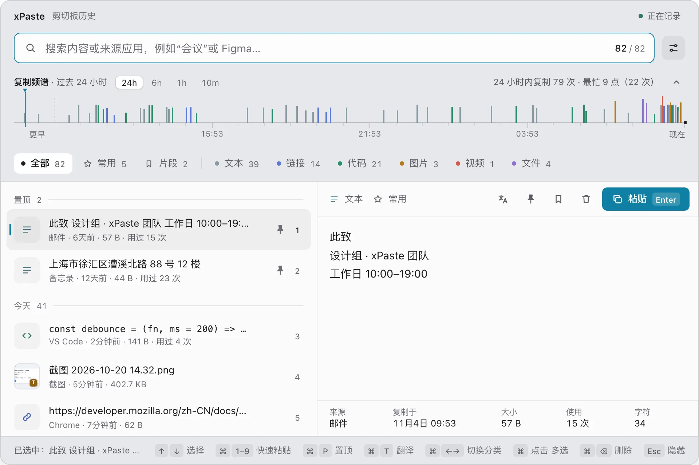
</picture>

面板从上到下是：

- **搜索框**：右边是命中条数和全部条数，最右边的按钮打开设置。
- **复制频谱**：过去 24 小时的复制，一次复制一根刻线，越高内容越大，见[按时间找](#按时间找复制频谱)。
- **分类**：全部、常用、片段，以及文本、链接、代码、图片、视频、文件，后面的数字是条数。
- **列表**：按今天、昨天、更早分组，置顶的排在最前；前 9 条右边有序号，按 `⌘` 加数字直接粘贴。
- **预览**：选中那一条的完整内容和来源、复制时间、大小、使用次数；右上角是翻译、置顶、存为片段、删除和粘贴按钮。
- **状态栏**：当前能用的快捷键，随状态变化。

macOS 上按 `Enter` 自动粘贴需要“辅助功能”权限：系统设置 → 隐私与安全性 → 辅助功能，打开 xPaste。不授权也能用，`Enter` 只复制并提示，到目标应用里按 `⌘ V` 即可。Windows 不需要权限，但粘贴不进以管理员身份运行的窗口，这时同样只复制并提示。

## 功能

### 搜索：关键词与拼音

输入的字在内容、标题、链接、文件名与路径、来源应用名里找，命中的字会标亮。三个字以上走本地全文索引，历史再多也是毫秒级。

不用切输入法：打全拼 `huiyi` 或首字母 `hy` 都能找到“会议”，多音字也认得（`yinhang` 能找到“银行”）。

<picture>
  <source media="(prefers-color-scheme: dark)" srcset="screenshots/guide/search-pinyin-dark.webp">
  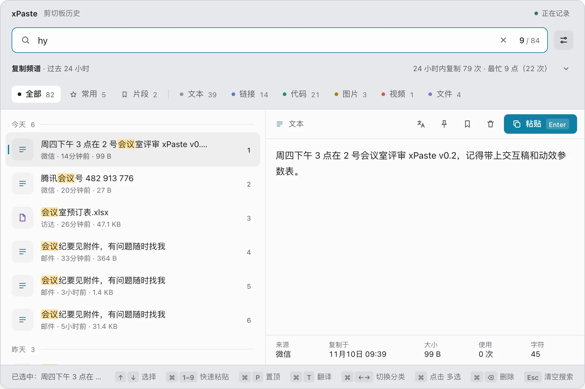
</picture>

### 截图、图片里的字

截图和复制的图片会在后台用系统自带的离线文字识别（macOS Vision、Windows.Media.Ocr）读出文字，不联网、不上传。只记得图里有个数字或一句话，照样能搜到；命中时列表行写明“识别文字中含……”。

<picture>
  <source media="(prefers-color-scheme: dark)" srcset="screenshots/guide/search-ocr-dark.webp">
  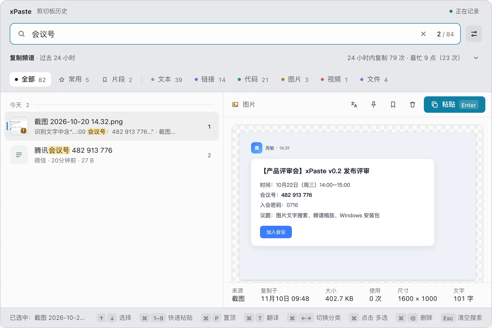
</picture>

预览里展开“图中文字”能看全文，点“复制文字”只复制文字，不产生新记录。应用启动后第一次识别要加载系统模型，大约 8 秒，之后每张通常不到 1 秒。设置“搜索”里可以关掉识别，或者关掉“为已有图片补识别”。

### 文件里的内容

在设置“搜索”里打开“搜索文本文件内容”（默认关）后，复制 txt、md、csv、json、代码等文件时，前 64 KB 的内容也进搜索范围（只用来搜，不显示）。macOS 上 PDF 里的文字也能搜到，最多读前 50 页，扫描件除外。忘了文件名，搜文件里写过的一句话就行。

<picture>
  <source media="(prefers-color-scheme: dark)" srcset="screenshots/guide/search-file-dark.webp">
  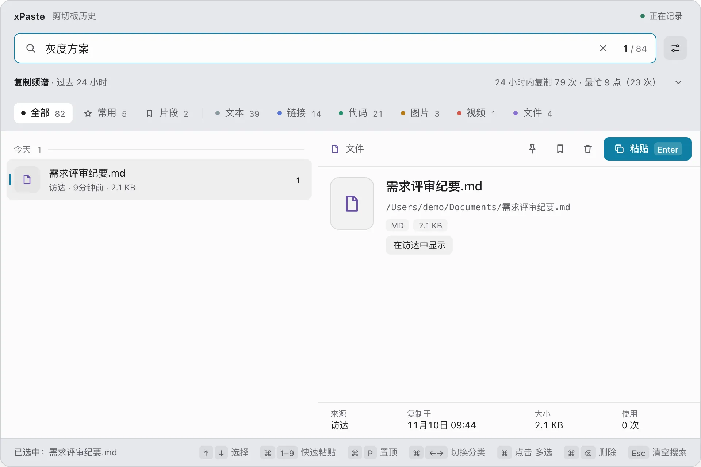
</picture>

内容只在复制时读一次，之后文件改了搜不到新内容；打开开关之前复制的文件不会补读。

### 来自哪个应用

只记得是从哪个应用复制的：输入应用名，拼音全拼或首字母也行（如 `wx`），搜索框右边出现“只看 微信 · N 条”。

<picture>
  <source media="(prefers-color-scheme: dark)" srcset="screenshots/guide/search-source-dark.webp">
  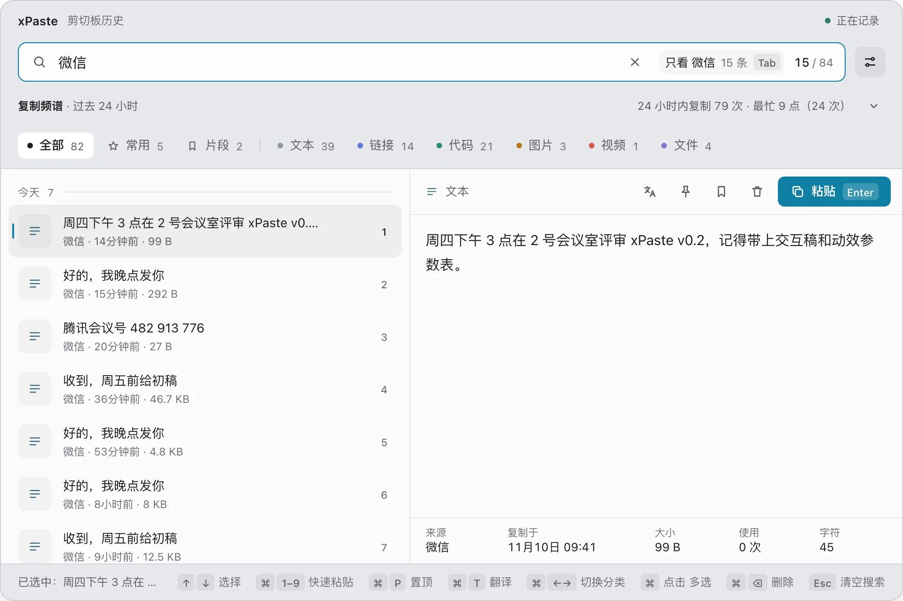
</picture>

按 `Tab`（或点它），输入的字变成搜索框里的胶囊，列表只剩这个应用的记录，接着输入的字只在这些记录里搜。

<picture>
  <source media="(prefers-color-scheme: dark)" srcset="screenshots/guide/search-source-cap-dark.webp">
  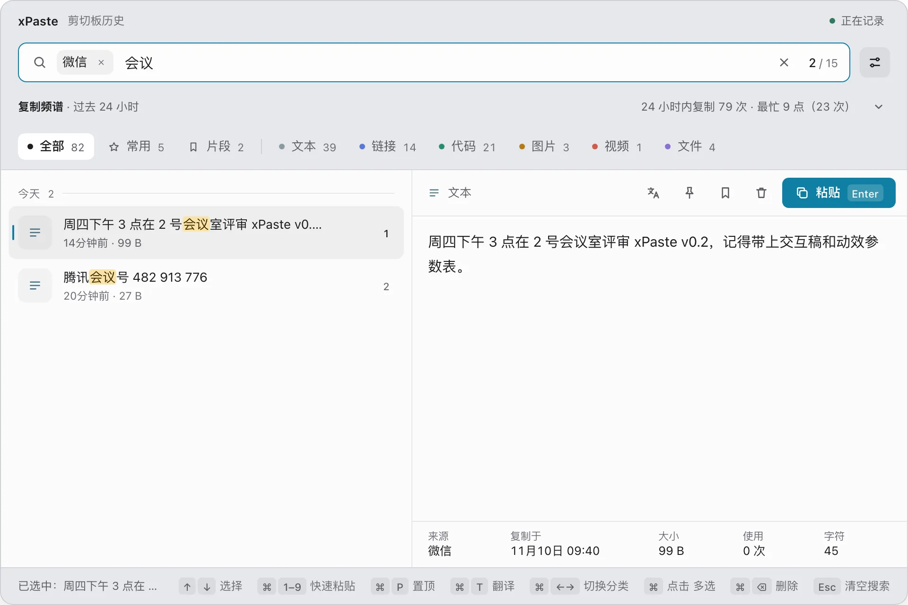
</picture>

- 不按 `Tab` 时一切照旧：输入“微信”也可能是想搜内容里带“微信”的记录。
- 搜索框为空时按 `⌫`，或者点胶囊上的 ×，去掉胶囊；`Esc` 依次清空搜索词、去掉胶囊、隐藏面板。
- 点预览底部的“来源”，也能直接只看这个应用。
- 面板隐藏后胶囊清空，下次唤起从头开始。

### 按时间找：复制频谱

面板顶部的复制频谱画的是过去 24 小时的复制，一次复制一根刻线，颜色是类型，越高内容越大。

<picture>
  <source media="(prefers-color-scheme: dark)" srcset="screenshots/guide/spectrum-dark.webp">
  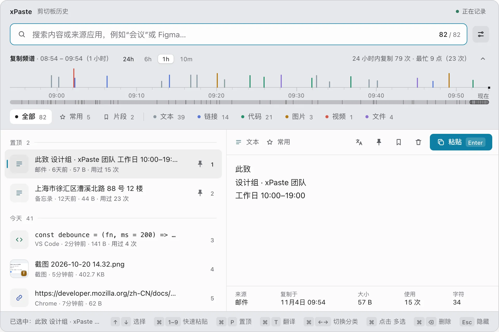
</picture>

- 滚轮或双指捏合放大，最小到几分钟；拖动平移；双击回到 24 小时。
- 标题行的 `24h` `6h` `1h` `10m` 直接跳到对应时长。
- 点一根刻线，选中对应的那一条；它被当前分类或搜索挡住时，会先回到“全部”。
- 点标题行收起，只留一行统计，列表多出一截。

### 分类与常用

用 `⌘ ←` / `⌘ →` 或点分类标签切换。“常用”里是同一条内容被复制了 3 次以上的记录（次数在设置里改），按使用次数排序。“片段”见[片段](#片段)。

### 粘贴

- `Enter`、双击一行、点预览右上角的“粘贴”，都是粘贴选中的那一条。
- `⌘ 1`–`⌘ 9` 直接粘贴列表里对应序号的那一条。
- 复制后这一条移到最上面（设置“通用”的“复制后移到顶部”，默认开），使用次数加 1。

**粘贴为纯文本**：从网页、文档复制来的文字带着字体和颜色。选中一条文本、代码或链接，按 `Shift + Enter`（或右键“粘贴为纯文本”），粘贴出去的只有文字本身。

**一次粘贴好几条**：按住 `⌘` 点几行（或按住 `Shift` 点、`Shift + ↑↓` 连选），行上出现 1、2、3 的序号，就是粘贴的先后。按 `Enter`（或点预览里的“合并粘贴”），各条按这个顺序连成一段、每条一行，作为纯文本粘贴一次。

<picture>
  <source media="(prefers-color-scheme: dark)" srcset="screenshots/guide/multi-dark.webp">
  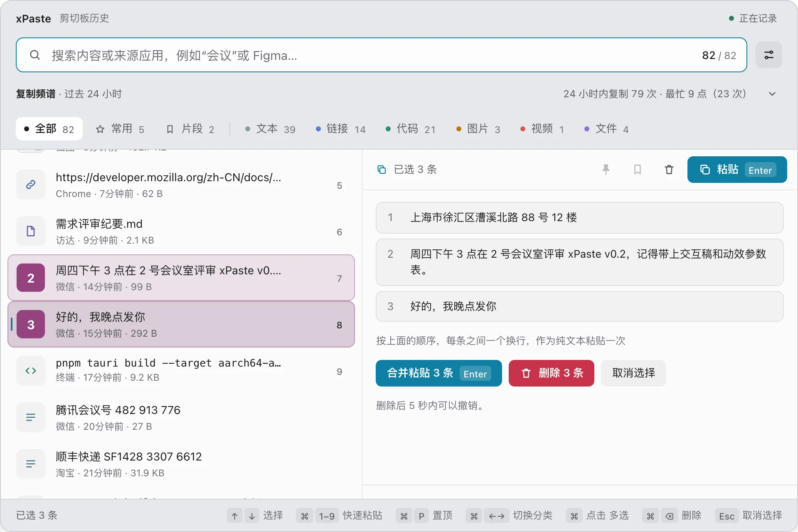
</picture>

- 选中的里面有图片、视频或文件时不能合并，按钮变灰并写明原因；批量删除照常可用。
- `Shift + ↑↓` 往回按会把多选的收回；`Esc`、不按修饰键点一行、不按 `Shift` 移动，都会退出多选。

### 整理：置顶、删除、右键菜单

右键一条记录（或按 `⇧ F10`）打开菜单：

<picture>
  <source media="(prefers-color-scheme: dark)" srcset="screenshots/guide/menu-dark.webp">
  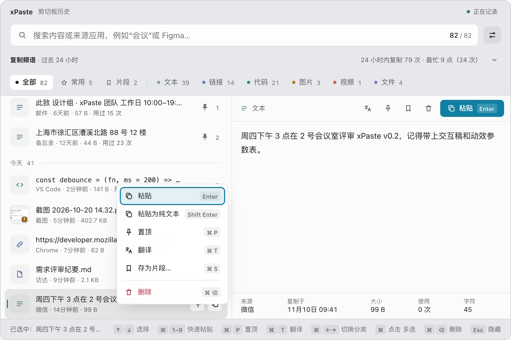
</picture>

- **置顶**（`⌘ P`）：排在列表最前，不受保留时长和条数上限清理。
- **删除**（搜索框为空时按 `⌦` 或 `⌘ ⌫`）：5 秒内按 `⌘ Z` 或点提示条上的“撤销”能恢复。多选后可以一次删除好几条，撤销也是一次恢复。
- **按类型的动作**：链接“在浏览器中打开”；文件、视频和来自文件的图片“在访达中显示”（Windows“在资源管理器中显示”）。
- **翻译**、**存为片段…**：见下面两节。

单独按 `⌫` 只删搜索框里的字，不会删记录。清空全部历史在设置“记录”里，置顶的记录和片段会保留。

### 片段

地址、回复模板、常用命令，存成片段就不会被清理掉：在历史记录上右键“存为片段…”（`⌘ S`），或者按 `⌘ N` 新建，起个名字。

<picture>
  <source media="(prefers-color-scheme: dark)" srcset="screenshots/guide/snippets-dark.webp">
  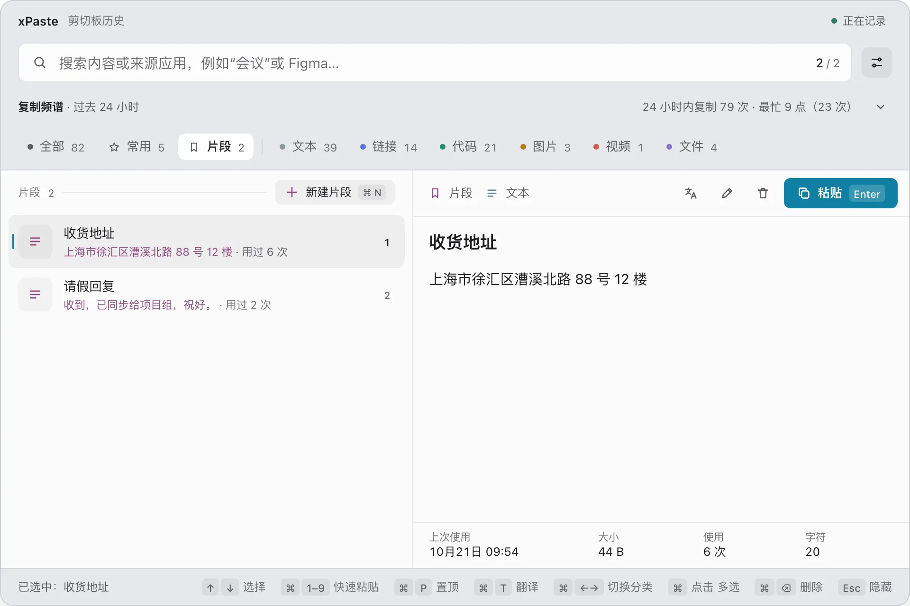
</picture>

- 在“全部”里搜名字（拼音、首字母也行）就能找到，命中的片段排在最前，`Enter` 粘贴出的是内容。
- 片段不受保留时长、最多条数和“清空历史”影响；改名、改内容（`⌘ E`）与删除在“片段”分类里，`⌘ A` 全选。
- 设置“记录”的“片段备份”：“导出…”把文字片段存成一个 JSON 文件，换电脑或重装后“导入…”。图片、文件片段依赖本机的文件，不导出；导入时名字和内容都一样的会跳过。

### 翻译

**面板里翻译**：选中一段文字（或有识别文字的截图、文件）按 `⌘ T`，或点预览右上角的翻译按钮。译文显示在预览里并存下来，下次直接看；“重新翻译”换目标语言后再翻。

<picture>
  <source media="(prefers-color-scheme: dark)" srcset="screenshots/guide/translate-dark.webp">
  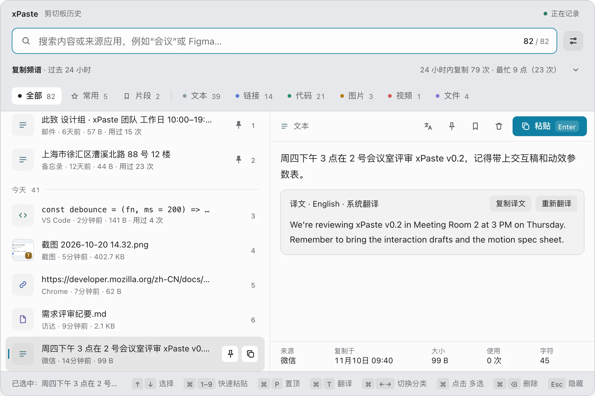
</picture>

**划词翻译**：在浏览器、终端等任何应用里选中文字，按 `⌥ ⇧ T`，译文卡片出现在文字旁。回车复制译文，`Esc` 或点别处关闭；点“对照原文”展开成左右两栏，可以改原文、换目标语言再翻。

<picture>
  <source media="(prefers-color-scheme: dark)" srcset="screenshots/guide/card-dark.webp">
  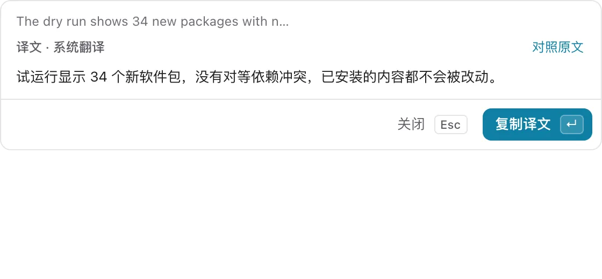
</picture>

**先写再翻**：点菜单栏图标的“翻译…”，或者不选文字直接按翻译快捷键，打开空的输入卡片。写完按 `⌘ ↵` 翻译，再按一次复制，回到聊天框粘贴即可；没写完关掉，下次打开草稿还在。

**两种翻译方式**，在设置“翻译”里配置：

- **系统翻译**：macOS 26 起可用，在本机完成，不联网；缺语言包时在设置里点“下载语言包”。
- **AI 翻译**：任意 OpenAI 兼容接口，包括本机的 Ollama，填接口地址、API Key 和模型 ID，点“测试翻译”确认能用。Windows 和 macOS 26 之前只有这一种。

两种都配好时，“默认翻译方式”决定先用哪种；每段译文都标出用的是哪种，旁边的“换用…”可以临时换另一种。只在你按翻译时才发送那一段文字。截图里也能翻译，见下一节。

### 截图、标注与贴图

按 `⌥ ⇧ A` 冻结所有屏幕：单击选中一个窗口，拖动框选区域，或按 `F` 选整块屏。选区可以拖手柄调整、拖动移动，方向键微调。

<picture>
  <source media="(prefers-color-scheme: dark)" srcset="screenshots/guide/shot-dark.webp">
  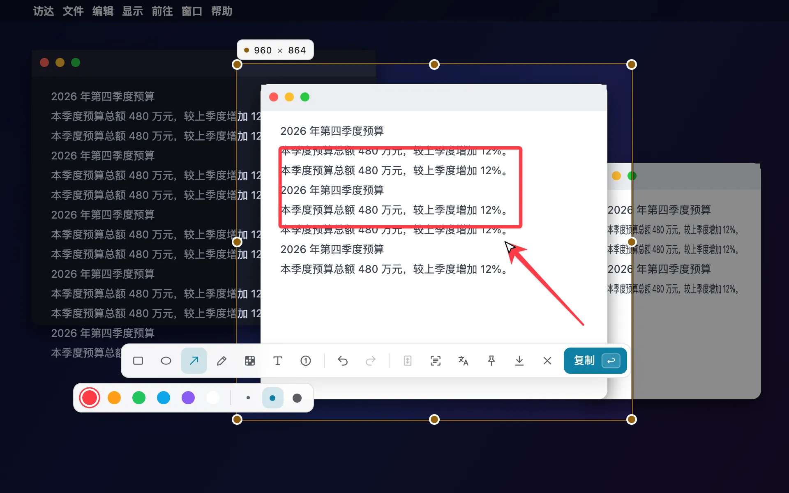
</picture>

| 按键 | 动作 |
| --- | --- |
| `1`–`7` | 矩形、椭圆、箭头、画笔、马赛克、文字、序号（再按一次取消） |
| `⌘ Z` / `⇧ ⌘ Z` | 撤销 / 重做 |
| `Enter`、双击选区 | 复制，截图直接进历史，之后能按图里的字搜到 |
| `⌘ S` | 保存到截图文件夹（默认 `~/Pictures/xPaste`），默认同时复制 |
| `O` | 只复制图里的文字，作为一条文本记录进历史 |
| `T` | 先识别再翻译，译文卡片出现在选区旁 |
| `P` | 钉在屏幕上（贴图） |
| `L` | 长截图 |
| `Esc` | 退出；右键先取消选区，再按一次退出 |

**贴图**：钉在屏幕上当参考，可以拖动、滚轮缩放（20%–400%），双击或 `Esc` 关闭；右键可以复制、保存、恢复原始大小。贴图只在本次运行内有效，退出 xPaste 就消失。

**长截图**：框选后按 `L`，自己往下滚动选区里的内容，xPaste 边滚边拼，选区旁有预览看接得对不对；`Enter` 完成、进历史，`Esc` 取消。滚得太快接不上时往回滚一点就能接着拼。能自动滚动时按空格让它自己滚到底（设置“截图”里可以改成按 `L` 就自动滚）。

macOS 第一次截图前要授予“屏幕录制”权限（系统设置 → 隐私与安全性 → 屏幕录制，macOS 15 起叫“录屏与系统录音”），授权后重新打开 xPaste。

### 录屏（仅 macOS）

按 `⌥ ⇧ R`，用和截图一样的遮罩选窗口、区域或整块屏，倒计时 3 秒后开始录制，录成 MP4。

- 录制中菜单栏显示 `● mm:ss`；再按一次快捷键，或点菜单栏的“停止录制”结束，结果显示在屏幕左下角。
- 视频存进录屏文件夹（默认 `~/Movies/xPaste`），同时作为视频记录进历史，可以直接粘贴。
- 遮罩工具栏上可以开关系统声音和麦克风（麦克风要 macOS 15），会被记住；清晰度、帧率在设置“录屏”里改。
- 录制中不能截图，先停止录制。只有从菜单栏“退出 xPaste”会先把视频写完再退出。

### 晾衣绳便签（Pro）

屏幕顶端放下一根晾衣绳，把要反复用的内容像便签一样夹在上面，随时取用。这是 xPaste Pro 的功能，官方安装包里带有，第一次运行起免费试用 14 天（从源码自己构建的版本不含）。

<picture>
  <source media="(prefers-color-scheme: dark)" srcset="screenshots/guide/line-dark.webp">
  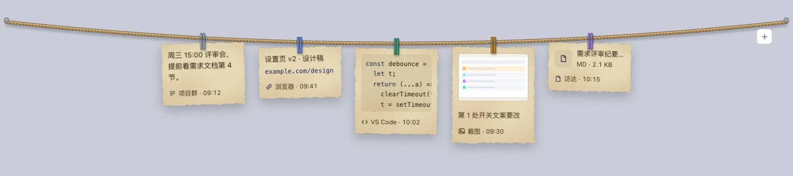
</picture>

**唤起**：鼠标碰到屏幕最顶端，停一下（约 0.2 秒）或者快速甩上去，绳子就放下；鼠标离开便签区域约 0.35 秒后收回，也可以按 `Esc`。菜单栏照常能点。有多块屏时，绳子出现在光标所在的那块屏。

**挂上去**：

- 按 `⌥ ⇧ N`（Windows `Alt + Shift + N`）：挂最近复制的一条；面板开着时，挂面板里选中的那条。绳子放下 2 秒后收回，不抢键盘焦点。
- 面板里每行有挂钩按钮，点一下就挂；也可以把行拖到屏幕顶端，松手的位置就是挂的位置。已经挂着的记录，行尾有一根彩色刻线。
- 从访达（资源管理器）把图片或文件拖到屏幕顶端，绳子放下，在想挂的位置松手。
- 最多挂 12 张。同一条内容不会重复挂，从面板或拖进来的内容已经挂着时，那张便签会轻轻摆一下；用快捷键再按一次则是选中它，见下面“键盘”。

**自己写**：点绳子右端的“＋”（或用键盘放下绳子后按 `N`），在绳尾新加一张空便签，直接输入。写一行网址会存成链接；在编辑框里 `⌘ V` 粘贴图片，便签变成图片，写过的字成为图片下的备注。便签的来源显示为“自己写”。

**编辑**：双击便签、悬停后点铅笔，或者选中后按 `E`。文字和代码改的是正文，链接、图片、文件、视频改的是下面一行备注。`⌘ ↵` 或点别处保存，`Esc` 取消；新写的便签空着就不会挂上去。

**整理**：

- 横着拖可以换顺序。
- 往下拽一段距离再松手、点“完成”或按 `⌫`，都能摘下便签；摘下后 4 秒内点“撤销”或按 `⌘ Z` 放回原处。
- 点一下文字、链接、代码便签展开看全；点图片、视频、文件便签（文字、代码也可悬停后点“展开”，或选中后按 `Enter`）弹出大卡片，看大图、直接播放视频、看全文和完整路径，点外面或按 `Esc` 关上。链接和文件另有“打开”。
- 便签里的内容和面板里的同类记录样子一致；删除历史记录、清空历史都不影响已经挂着的便签。

**提醒**：悬停后点闹钟，选“10 分钟后”“30 分钟后”“1 小时后”“明天上午 9 点”或自定义时间，便签底下那一行会换成闹钟和提醒时间。到点时绳子自己放下，那张便签高亮，同时弹一条系统通知；点“10 分钟后再提醒”可以推后。应用没开着时错过的提醒，下次打开时补上。

**用起来**：用键盘选中便签后按 `⌘ C`，把内容放进剪切板，再回到应用里粘贴。图片、文件、视频在原记录还在时按原记录复制；原记录已经删了，图片复制图片本身，文件和视频复制路径文字。

**键盘**：绳子放下后，点一下便签（或点“＋”）让键盘交给它；或者再按一次 `⌥ ⇧ N`（刚挂上的那条还在绳上、绳子还没收起时），会选中它并改用键盘操作。然后用 `←` `→` 选便签，`Enter` 打开大卡片，`E` 编辑，`N` 新写，`⌫` 摘下，`⌘ C` 复制，`Esc` 收起。

**试用与授权码**：试用期间绳尾的挂钩下方写着“试用剩 N 天”。试用结束后不能再挂新便签、写新便签，提示里点“输入授权码”打开设置的“Pro”标签；已经挂着的便签照常能看、改、复制、摘下。收到授权码后粘贴到“Pro”标签里即可，授权码在本机验证，不联网。授权覆盖购买时的大版本（如 1.x），这个大版本里的所有更新都能用；升级到新的大版本需要重新购买。

开了系统的“减少动态效果”时，绳子的放下和收起改成淡入淡出，便签不摆动。快捷键可以在设置“Pro”里改，清空就是不启用。设置“Pro”里还可以换晾衣绳的绳子、夹子和便签纸。便签只存在本机。

### 精简模式

只想搜一下、贴回去：设置“通用”里把“面板样式”改成“精简”，面板就只剩搜索框和一行一条的列表。

<picture>
  <source media="(prefers-color-scheme: dark)" srcset="screenshots/guide/compact-dark.webp">
  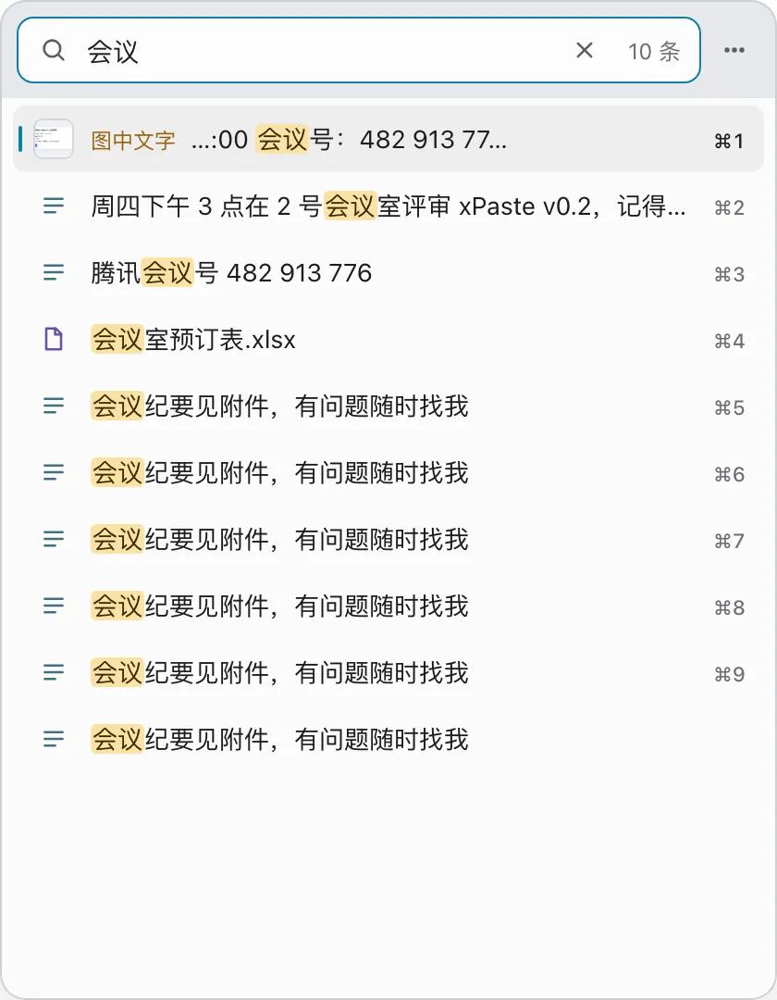
</picture>

- 搜索框为空时按空格（有字时按 `⌘ Y`）预览选中的那一条，↑↓ 换条，再按一次或 `Esc` 关闭。
- `⌘ ←` / `⌘ →` 照常切换分类，当前分类显示成搜索框里的标签，搜索框为空时按 `⌫` 去掉。
- 置顶、删除、存为片段在右键菜单里；右上角“更多”菜单可以切回完整面板、暂停记录、打开设置。
- 精简面板的尺寸和完整面板分别记住。

## 设置

按 `⌘ ,` 或点搜索框右边的按钮打开设置。改完点“保存设置”生效（外观点选即生效）；`Esc` 或点外面关闭，不保存。

<picture>
  <source media="(prefers-color-scheme: dark)" srcset="screenshots/guide/settings-dark.webp">
  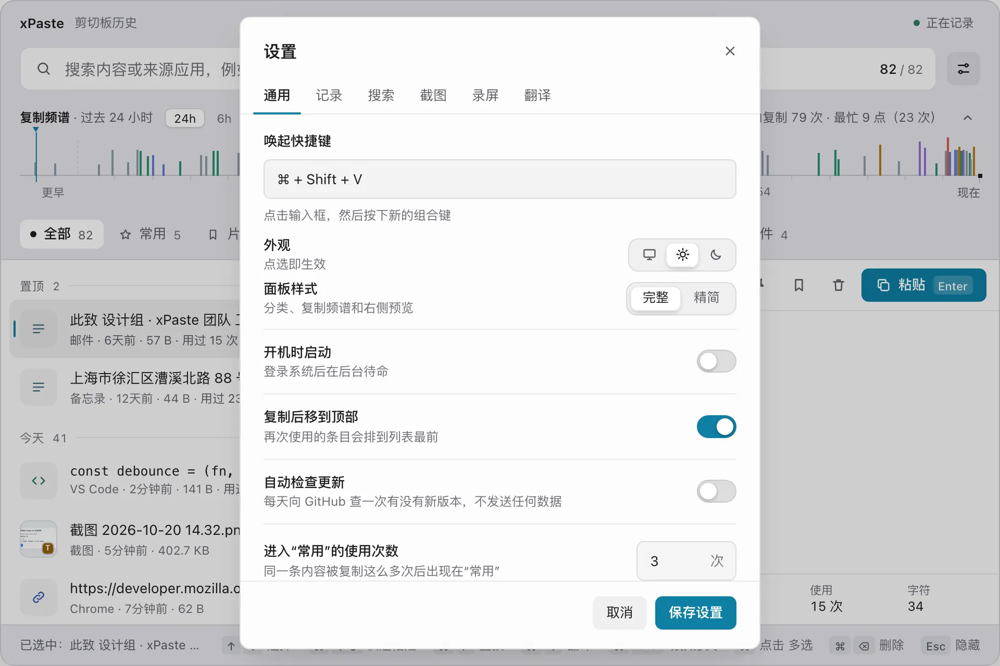
</picture>

| 标签 | 能改什么 |
| --- | --- |
| 通用 | 唤起快捷键；外观（跟随系统 / 亮色 / 暗色）；面板样式（完整 / 精简）；开机时启动；复制后移到顶部；自动检查更新；进入“常用”的使用次数（默认 3）；自动粘贴权限（macOS）；导出日志 |
| 记录 | 历史保留（7 / 30 / 90 天 / 永久，默认 30 天）；最多保存（50–5000 条，默认 500）；不记录这些应用（默认 1Password、钥匙串访问，Windows 为 1Password、KeePass、Bitwarden）；跳过密码管理器与敏感内容；新建片段；片段备份（导入、导出）；清空历史 |
| 搜索 | 识别图片中的文字；为已有图片补识别；搜索文本文件内容（默认关） |
| 截图 | 截图快捷键；截图文件夹；保存截图时同时复制；屏幕录制权限（macOS）；长截图自动滚动 |
| 录屏（仅 macOS） | 录屏快捷键；录屏文件夹；清晰度（高 / 标准 / 小文件）；帧率（30 / 60 fps）；录制系统声音；录制麦克风；录完复制到剪切板 |
| 翻译 | 翻译快捷键；默认翻译方式（macOS 26 起）；系统翻译的语言包；AI 翻译的接口地址、API Key、模型 ID；目标语言；测试翻译 |
| Pro | 晾衣绳便签快捷键（默认 `⌥ ⇧ N`，清空即不启用）；试用与授权状态；输入授权码。只有官方安装包里有这个标签 |

快捷键录制框：点一下再按下新的组合，至少要带一个修饰键；截图、录屏、翻译快捷键在录制框里按 `⌫` 清空，就是不启用。快捷键被其他应用占用时，保存会失败并指出是哪一个。

## 菜单栏与托盘

macOS 点菜单栏图标打开菜单；Windows 单击托盘图标切换面板，右键打开菜单。

- **打开 xPaste**：显示当前的唤起快捷键。
- **翻译…**：打开空的输入卡片，见[翻译](#翻译)。
- **暂停记录 / 继续记录**：暂停期间复制的内容不进历史，图标变成暂停样式，重启后仍然有效。精简面板里点“已暂停”也能继续。
- **清空历史…**、**设置…**。
- **导出日志**：把日志和最近 30 天的崩溃报告打成一个 zip 放进“下载”文件夹，反馈问题时发给开发者，里面不含剪切板内容。
- **下载新版本 x.y.z…**：只在有新版本时出现，见下面。
- 灰色的“xPaste <版本>”是当前版本号；**退出 xPaste**。

**检查更新**：设置“通用”里的“自动检查更新”默认开着，每天向 GitHub 查一次有没有新版本，请求里只有版本号。有新版本时发一次通知，菜单里多出“下载新版本…”，设置里也有“前往下载”。不会自动安装：下载新的安装包覆盖安装即可，用 Homebrew 装的执行 `brew upgrade --cask xpaste`。

## 快捷键一览

全局快捷键在任何应用里都能按，都可以在设置里改；截图、录屏、翻译、晾衣绳便签的可以不启用。

| 操作 | macOS | Windows |
| --- | --- | --- |
| 唤起 / 隐藏面板 | `⌘ ⇧ V` | `Ctrl + Shift + V` |
| 截图 | `⌥ ⇧ A` | `Alt + Shift + A` |
| 录屏 / 停止录制 | `⌥ ⇧ R` | 不支持 |
| 划词翻译 | `⌥ ⇧ T` | `Alt + Shift + T` |
| 挂上晾衣绳便签（Pro） | `⌥ ⇧ N` | `Alt + Shift + N` |

面板里：

| 操作 | macOS | Windows |
| --- | --- | --- |
| 搜索 | 直接输入 | 直接输入 |
| 上一条 / 下一条 | `↑` / `↓` | `↑` / `↓` |
| 粘贴选中的一条；多选时合并粘贴 | `Enter` | `Enter` |
| 粘贴为纯文本 | `⇧ Enter` | `Shift + Enter` |
| 粘贴第 1–9 条 | `⌘ 1`–`⌘ 9` | `Ctrl + 1`–`Ctrl + 9` |
| 多选 | `⌘` 点击、`⇧` 点击、`⇧ ↑` / `⇧ ↓` | `Ctrl` 点击、`Shift` 点击、`Shift + ↑` / `Shift + ↓` |
| 全选（“片段”分类，搜索框为空时） | `⌘ A` | `Ctrl + A` |
| 切换分类 | `⌘ ←` / `⌘ →` | `Ctrl + ←` / `Ctrl + →` |
| 置顶 / 取消置顶 | `⌘ P` | `Ctrl + P` |
| 翻译 | `⌘ T` | `Ctrl + T` |
| 存为片段 / 编辑片段 / 新建片段 | `⌘ S` / `⌘ E` / `⌘ N` | `Ctrl + S` / `Ctrl + E` / `Ctrl + N` |
| 删除（搜索框为空时） | `⌦` 或 `⌘ ⌫` | `Delete` 或 `Ctrl + Backspace` |
| 撤销删除（5 秒内） | `⌘ Z` | `Ctrl + Z` |
| 右键菜单 | `⇧ F10` | 菜单键或 `Shift + F10` |
| 来源筛选：接受建议 / 去掉胶囊 | `Tab` / 搜索框为空时 `⌫` | `Tab` / 搜索框为空时 `Backspace` |
| 精简模式：预览 | 空格（搜索框为空时）或 `⌘ Y` | 空格（搜索框为空时）或 `Ctrl + Y` |
| 打开设置 | `⌘ ,` | `Ctrl + ,` |
| 取消多选 / 清空搜索 / 隐藏面板 | `Esc` | `Esc` |

截图遮罩里的按键见[截图、标注与贴图](#截图标注与贴图)。

## 数据与隐私

数据只存在本机，不同步、不收集使用统计。会联网的只有两件事：翻译，只在你手动翻译时把那段文字发到你在设置里配置的接口（接本机服务或用系统翻译时不出本机）；检查更新，每天向 GitHub 查一次有没有新版本，不发送任何数据，可在设置“通用”里关掉。数据目录：

- macOS：`~/Library/Application Support/xPaste/`
- Windows：`%APPDATA%\xPaste\`

设置里可以“清空历史…”，置顶的记录与片段会保留。数据库没有加密，是本机明文 SQLite，靠系统账户权限保护。

## 卸载

- **macOS**：
  1. 从菜单栏图标选“退出 xPaste”，把应用拖进废纸篓。
  2. 要连数据一起删，还需手动删除这些位置：
     - 上面的数据目录；
     - `~/Library/LaunchAgents/` 下 xPaste 的 plist（开过“开机时启动”才有）；
     - WebView 留下的 `~/Library/WebKit/com.xpaste.app` 和 `~/Library/Caches/com.xpaste.app`。
- **Windows**：在“设置 → 应用”里卸载。要删历史数据，在卸载确认页勾选“删除应用程序数据”。
- **Homebrew**：`brew uninstall --cask xpaste` 只删应用、保留历史记录；`brew uninstall --zap --cask xpaste` 连上面的数据目录、缓存和开机启动项一起删。

## 已知限制

- 有新版本只提醒、不自动安装，要手动下载安装。Windows 安装包没有签名。
- Windows 端的翻译、划词翻译已在实机上验收，截图、贴图、长截图还只在 CI 上编译并跑通单元测试；图片文字识别依赖系统已安装的 OCR 语言包。
- macOS 分 Apple 芯片和 Intel 两个安装包，没有通用版本。
- 截图的选区不能跨显示器；贴图退出 xPaste 就消失，重启不恢复。macOS 15 起系统会定期再次询问是否继续允许屏幕录制。
- 录屏只支持 macOS，麦克风要 macOS 15；同时录系统声音和麦克风时是两条音轨，有的播放器只播第一条。只有从菜单栏“退出 xPaste”会先把视频写完，录制中注销、关机或用 `⌘ Q` 结束 xPaste 时，正在录的视频无法播放。
- 应用启动后第一次识别图片要加载系统模型，大约 8 秒，之后每张通常不到 1 秒。
- 晾衣绳便签：全屏应用里鼠标碰到顶端时，系统菜单栏会和晾衣绳一起出来。
- 翻译要联网，接本机服务（如 Ollama）时除外；系统翻译需要 macOS 26，命令、路径也会被翻译；Windows 上没有系统翻译，只能用 OpenAI 兼容接口。划词翻译在 macOS 上要“辅助功能”权限；Windows 上用 `Ctrl + Insert` 取词，个别不认它的应用里翻译的是剪切板里原有的文字。

完整列表（包括性能测量结果、各平台的细节）见 [已知限制](已知限制.md)；各系统、芯片、显示器与权限下哪些功能可用、不可用时有什么提示，见 [设备支持](设备支持.md)。
